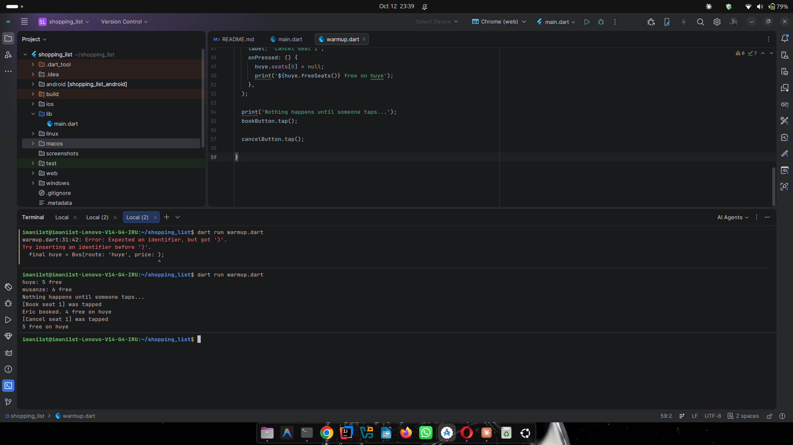
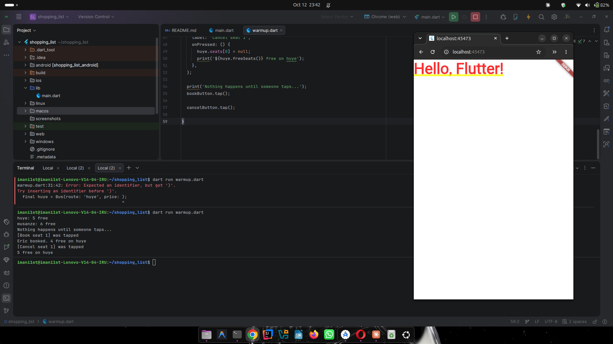
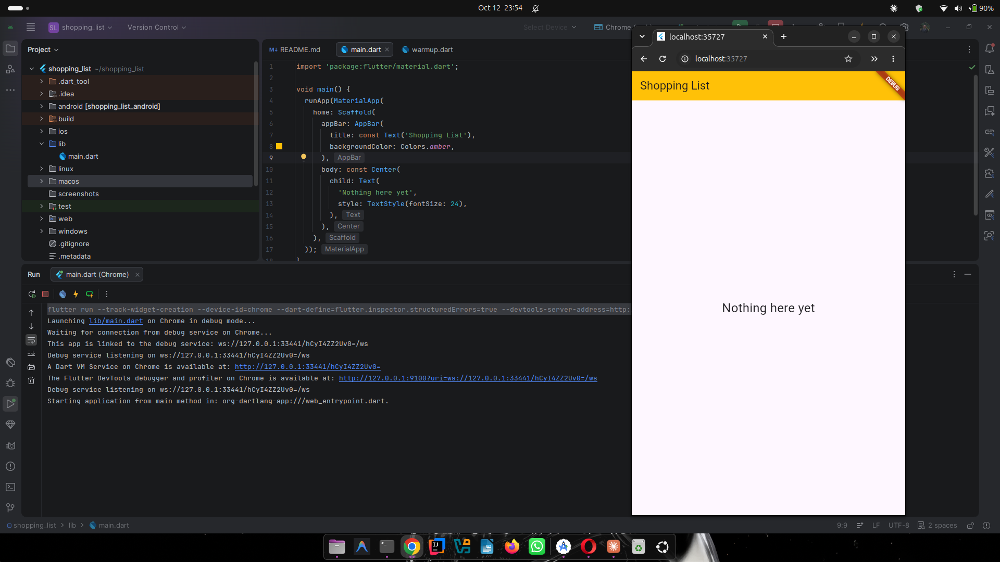
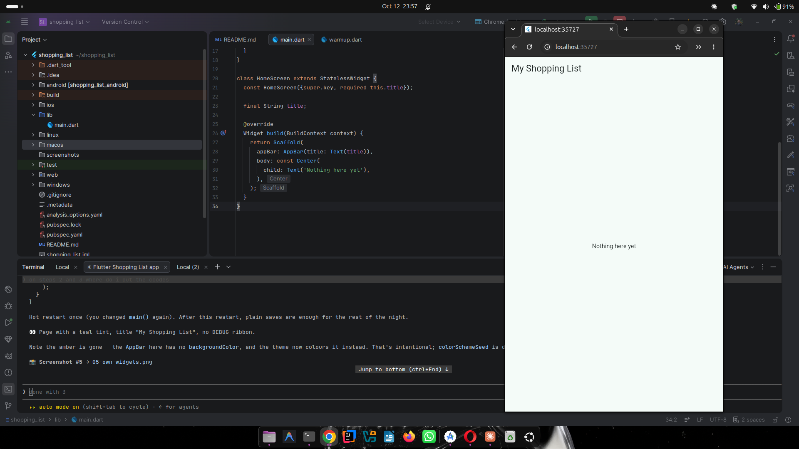
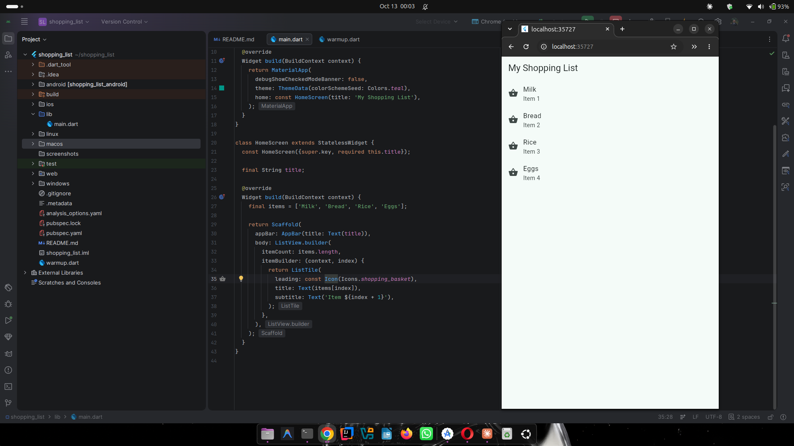
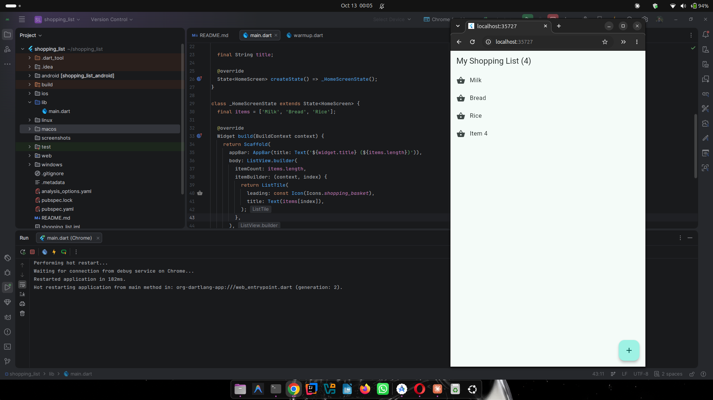
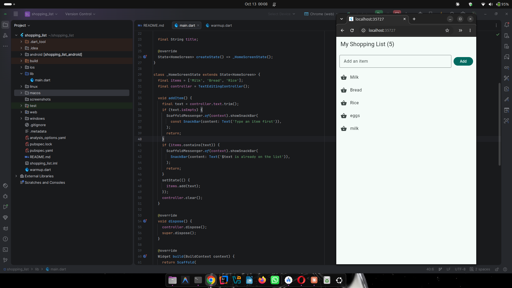
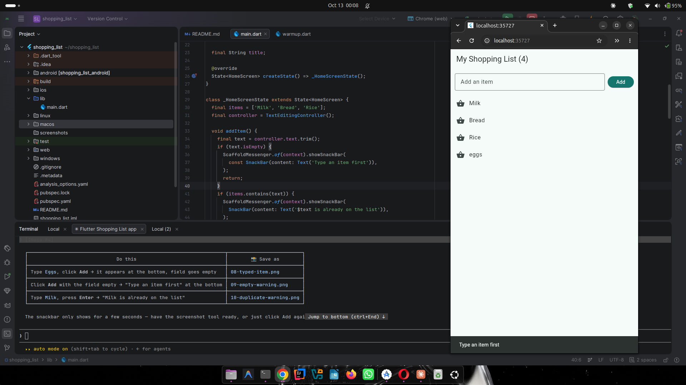
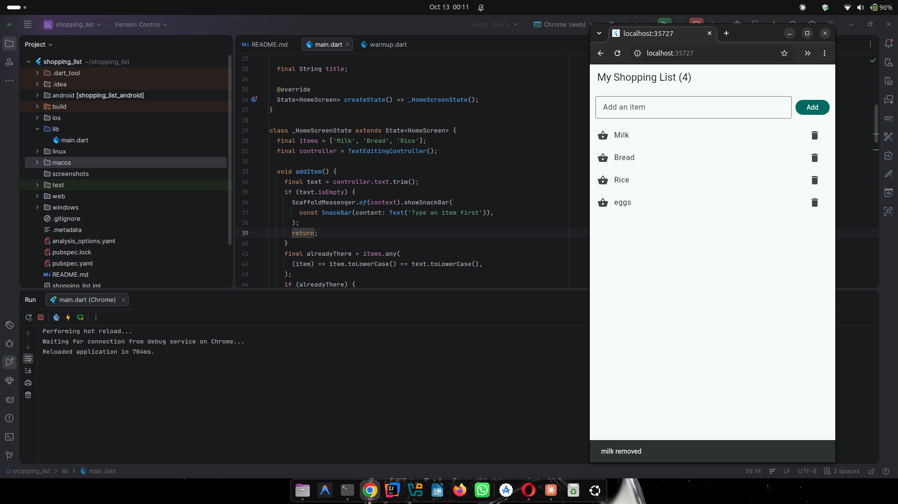
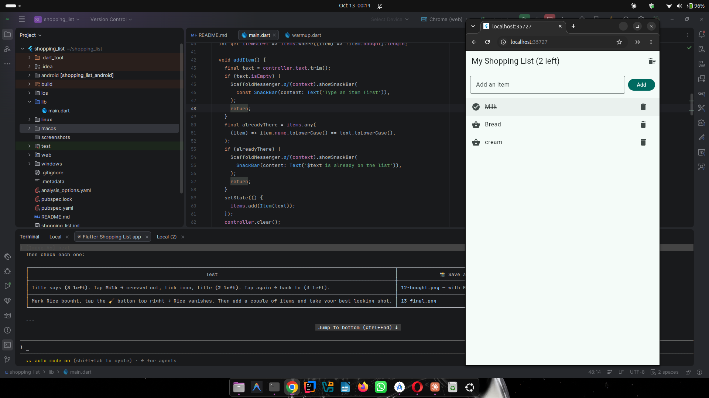

# Shopping List — Flutter

**Mobile Programming · Week 2 · Session 3**

My first Flutter app. Type an item, tap **Add**, and it appears in the list. Tap an
item when you have bought it and it gets crossed out, tap the bin to delete it, and
use the button in the top bar to clear everything you have already bought.

Built step by step in `lib/main.dart`, running on Chrome (web) with Flutter 3.47.7.

---

## What it does

- Starts with **Milk, Bread, Rice** and a title showing how many items are left.
- Typing an item and pressing **Add** (or **Enter**) puts it at the end of the list
  and empties the field.
- An empty field is refused with the message **"Type an item first"**.
- An item already on the list is refused with **"<name> is already on the list"**.
  The check ignores capitals, so `milk` and `Milk` count as the same item.
- Each row has a bin that deletes **only that row**, and says so afterwards.
- Tapping a row marks it as bought: the name is crossed out, the basket icon becomes
  a tick, and the count in the title goes down. Tapping again undoes it.
- The 🧹 button in the top bar removes every bought item at once.
- When the list is empty the page shows **"Your list is empty"**.

---

## How to run it

```bash
flutter pub get
flutter run -d chrome
```

To run on an Android emulator or a phone instead, start the device first and use
`flutter run` without the `-d chrome`.

The Dart warm-up exercise is a separate console program:

```bash
dart run warmup.dart
```

---

## Step by step

### Warm-up — classes, named parameters, functions as values

Plain Dart before any Flutter: a `Bus` class, named parameters, and a `Button` whose
`onPressed` function is stored and only called later when `tap()` runs. The first run
below shows the deliberate error from leaving out a `required` parameter, then the
working output including my own `cancelButton`.



### Step 1 — Hello, Flutter

`runApp` with a `MaterialApp` whose `home` is a bare `Text`. Red letters, yellow
underlines and a DEBUG ribbon — the text has no page under it to give it a style.



### Step 2 — A real page

A `Scaffold` gives the app a proper page: an `AppBar` at the top and a `body`
underneath. I gave the bar `backgroundColor: Colors.amber` and made the text bigger
with `style: TextStyle(fontSize: 24)`.



### Step 3 — My own widgets

The screen moved into my own classes, `ShoppingApp` and `HomeScreen`, both extending
`StatelessWidget`. `ThemeData(colorSchemeSeed: Colors.teal)` colours the whole app
from one seed colour, and `debugShowCheckedModeBanner: false` hides the DEBUG ribbon.



### Step 4 — Show a list

`ListView.builder` with `itemCount` and `itemBuilder`. Flutter calls `itemBuilder`
once per row with that row's `index`, and each row is a `ListTile` with a basket icon
and the item's name. The second line uses `index + 1` so the rows read "Item 1, Item
2…" rather than starting at zero.



### Step 5 — Make it react

`HomeScreen` became a `StatefulWidget` split in two: the widget holds what never
changes (`title`), and `_HomeScreenState` holds what does (`items`). The `+` button
calls `setState`, which tells Flutter to run `build` again so the new row appears.

`items` lives outside `build` — inside it, the list would be created fresh on every
redraw and anything I added would be lost.



### Step 6 — Type my own items

A `TextField` and an **Add** button sit above the list in a `Row` inside a `Column`.
A `TextEditingController` holds what is typed; `controller.text` reads it and
`controller.clear()` empties it after a successful add.

Two `Expanded` widgets, for two different reasons: around the `TextField` so it does
not ask for infinite width inside the `Row`, and around the `ListView` so it does not
ask for infinite height inside the `Column`.



Tapping **Add** on an empty field adds nothing and shows a `SnackBar` instead. The
rule checks first and `return`s early, so nothing reaches the list.



### Step 7 — Delete an item

Every row gets its own `IconButton` in the `ListTile`'s `trailing` slot, and each
one's `onPressed` closure remembers that row's `index` — so the bin next to Bread
deletes Bread and nothing else. The item's name is read **before** `removeAt`, since
after the removal that index points somewhere else.



### Step 8 — Mark as bought

A text is no longer enough, so the data became a model class:

```dart
class Item {
  Item(this.name);

  final String name;
  bool bought = false;
}
```

`name` is `final` because an item's name never changes; `bought` is a plain `bool`
because it flips on every tap. Tapping a row toggles it, `itemsLeft` counts the
items that are not bought, and the top-bar button calls `removeWhere` to drop every
bought item in one pass.

Changing the stored data from `List<String>` to `List<Item>` needs a **hot restart**,
not a hot reload — a reload keeps the old data, which no longer matches the new code.



---

## The map of the app

```
main()                 starts the app
Item                   the model: a name and a bought status
ShoppingApp            the app: its theme and its first screen
HomeScreen             the screen's settings: its title
_HomeScreenState       the screen's data and logic
  ├─ items             the data: a list of Item
  ├─ controller        what is typed in the field
  ├─ itemsLeft         how many items are not bought yet
  ├─ addItem()         the rules for adding
  ├─ removeItem()      delete one row
  ├─ toggleBought()    mark / un-mark as bought
  ├─ clearBought()     remove every bought item
  ├─ dispose()         clean-up when the screen closes
  └─ build()           draws the screen from the data:
       Scaffold
       ├─ AppBar             title with the count + clear button
       └─ Column
          ├─ Padding → Row   TextField + Add button
          └─ Expanded → ListView.builder
                └─ ListTile  icon, name, bin button
```

---

## Think

**1. Close the app completely and run it again. What happened to the list?**

Everything I added is gone and the list is back to Milk, Bread and Rice. The items
live in `_HomeScreenState`, which only exists in memory while the app is running —
closing the app throws it away, and starting again runs the field initialiser from
scratch. To survive, the list would have to be written somewhere outside the app's
memory: a file on the device, a local database, or a server.

**2. What happens from tapping Add to the new row on screen?**

1. The tap reaches the `FilledButton`, which calls the function it was given in
   `onPressed: addItem`. Note there are no brackets — the button was handed the
   function itself, to call later, not the result of calling it.
2. `addItem` reads `controller.text` and `.trim()`s it, so spaces alone count as
   empty.
3. If the text is empty, a `SnackBar` appears and `return` stops the method — nothing
   is added.
4. If an item with the same name already exists (ignoring capitals), a different
   `SnackBar` appears and `return` stops it again.
5. Otherwise `setState` runs. Inside it, `items.add(Item(text))` changes the data;
   `setState` then tells Flutter the state is dirty.
6. Flutter calls `build` again. `ListView.builder` sees `items.length` has grown by
   one and calls `itemBuilder` for the new index, which returns a new `ListTile`.
7. The AppBar's `itemsLeft` is recalculated at the same time, so the count updates
   together with the row.
8. Back in `addItem`, `controller.clear()` empties the field.

---

## What I used

| Piece | What it does |
|---|---|
| `StatelessWidget` | A widget that never changes by itself |
| `StatefulWidget` + `State` | A widget with data that changes |
| `setState` | "I changed the data, redraw the screen" |
| `Scaffold`, `AppBar`, `Column`, `Row`, `Expanded`, `Padding` | Page structure and layout |
| `ListView.builder`, `ListTile` | A scrolling list, built one row at a time |
| `TextField` + `TextEditingController` | Typing text and reading it |
| `SnackBar` | A short message at the bottom of the screen |
| `Item` | A model class describing the data, separate from the screen |
